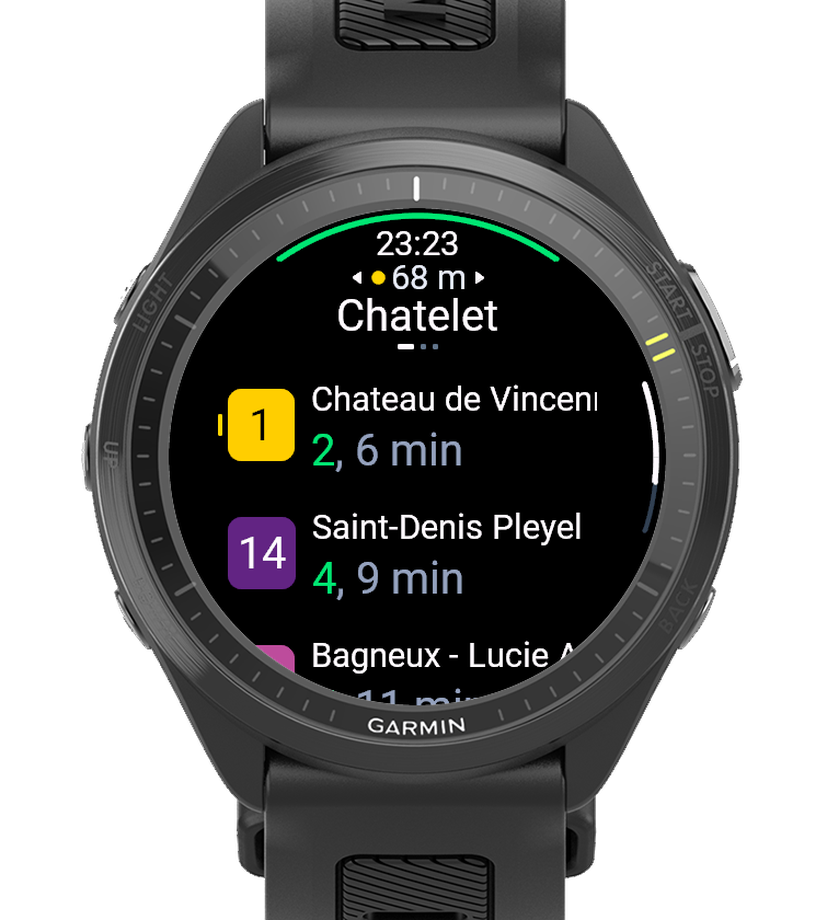
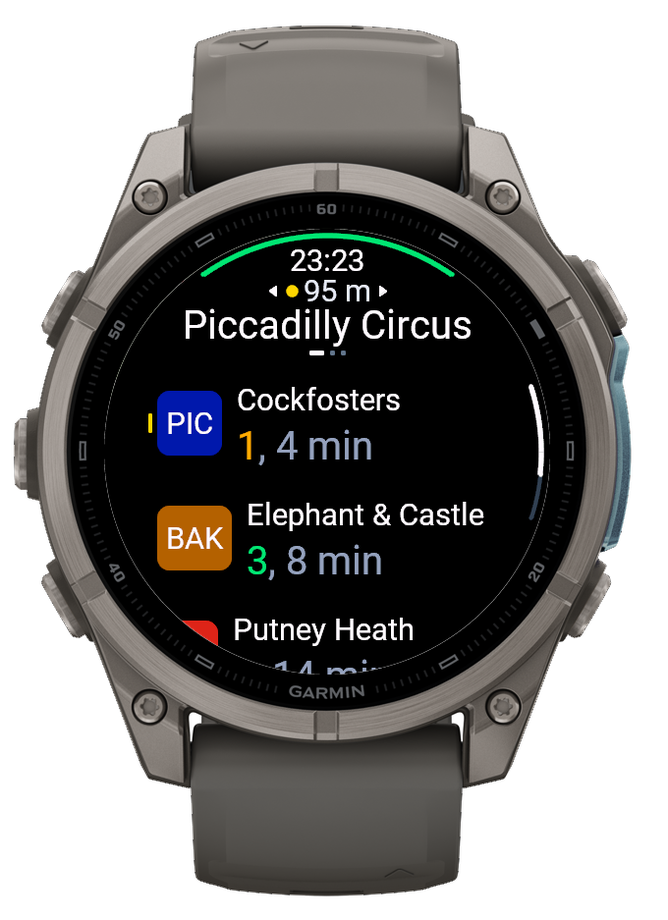
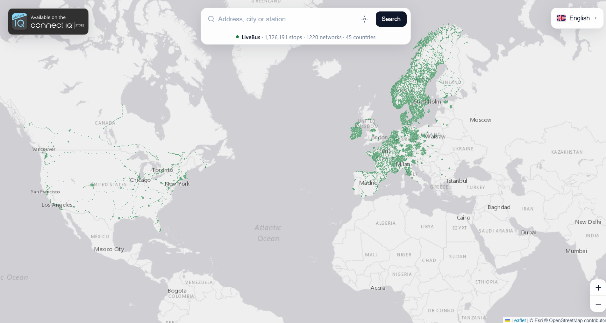

# LiveBus

Real-time public transit departures from any stop, for Garmin watches.

 
 

- **1.3M+ stops** across **380+ cities**, **1,200+ networks**, and **45+ countries**
- **Bus, Metro, Tram & Rail** with official line colors and live countdowns
- **Automatic GPS stop detection**, Glance widget, favorites, and walking time
 

  
 

